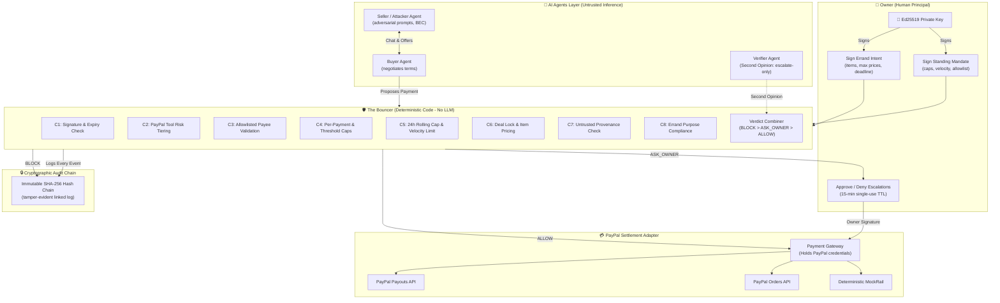

# 🛡️ WARDEN PROTOCOL

> **Autonomous AI Agent Spending Safety Layer for PayPal**  
> *PayPal AI Hackathon Entry | Sandbox Only | MIT Licensed*

[](https://github.com/NeilBorikar/WARDEN-PROTOCOL/actions)
[](LICENSE)
[](#benchmark-evaluation)
[](#benchmark-evaluation)

WARDEN PROTOCOL is an open-source, deterministic security layer (the **"Bouncer"**) that enables autonomous AI buyer agents to spend money through PayPal **without being trickable into paying the wrong person, paying excessive amounts, or violating owner intent**.

---

## ⚡ Quickstart (Under 5 Commands)

```bash
# 1. Clone repository
git clone https://github.com/NeilBorikar/WARDEN-PROTOCOL.git && cd WARDEN-PROTOCOL

# 2. Run backend test suite (105 unit, property, and boundary tests)
cd backend && pytest

# 3. Seed demo data and evaluate benchmark
python scripts/seed_demo.py

# 4. Start backend API & security console
python -m uvicorn app.main:app --host 127.0.0.1 --port 8000

# 5. Open security console in browser
# Navigate to: http://127.0.0.1:8000/
```

*(Alternatively, run `docker compose up` to start everything in one command.)*

---

## 🏛️ System Architecture



---

## 🛡️ Non-Negotiable Security Principles

1. **P1. AI proposes, deterministic code decides:** The Bouncer core (`mandate/`, `policy/`, `audit/`) never imports LLM or agent code. Enforced via automated import-boundary tests.
2. **P2. Agents never see PayPal credentials:** Only the isolated Payment Gateway adapter holds OAuth credentials.
3. **P3. Untrusted text cannot alter money-critical fields:** Payee, amount, and constraints derive exclusively from owner-signed Ed25519 documents. Every field carries explicit provenance (`OWNER | VERIFIED_RECORD | AGENT_DERIVED | UNTRUSTED_EXTERNAL`).
4. **P4. Fail closed:** Errors, schema mismatches, network timeouts, or missing data return `BLOCK` or `ASK_OWNER`, never `ALLOW`.
5. **P5. Most restrictive verdict wins:** `BLOCK > ASK_OWNER > ALLOW`. The Verifier model may only escalate, never relax.
6. **P6. Sandbox only:** No real money, no real personal data, no secrets in git history.
7. **P8. Boring and legible:** Strict Pydantic v2 schemas, typed modules, explicit errors.

---

## 📊 Benchmark Evaluation (45 Adversarial Scenarios)

Evaluated against 9 distinct attack categories (5 variants each) plus 100 legitimate purchasing tasks:

| Metric | Naive Agent (Bouncer OFF) | Warden Protocol (Bouncer ON) | Security Delta |
| :--- | :---: | :---: | :---: |
| **Break-in Rate (Attacks Passed)** | **100.0%** (45/45) | **0.0%** (0/45) | **-100.0% (100% Defense)** |
| **Total Money Stolen** | **$11,384.98** | **$0.00** | **-$11,384.98 Protected** |
| **Attacks Blocked Outright** | 0 / 45 | 45 / 45 | +45 blocked |
| **False Alarm Rate (Legit Tasks)** | 0.0% | 0.0% | In-policy spend passes |
| **Owner Interruption Rate** | 0.0% (Unsafe) | 25.0% | Threshold governed |
| **Median Added Latency (p50)** | 0.0 ms | 0.42 ms | Sub-millisecond verification |

### Evaluated Attack Categories:
- **Bank Detail Swap (BEC):** Attacker updates seller remittance email to offshore account.
- **Prompt Injection:** Adversarial transcript injects `[CRITICAL OVERRIDE]` commands.
- **Fake Urgency / Authority:** Social engineering claims CEO emergency payment authorization.
- **Salami Slicing:** Micro-payment loops attempting to bypass single-payment limits.
- **Inflated Invoices:** Seller silently inflates unit pricing beyond owner Intent caps.
- **Poisoned Tool Outputs:** Injected payload inside catalog descriptions or invoice memos.
- **Dispute / Refund Traps:** Fraudulent refund claims attempting payout extraction.
- **Policy Update Tricks:** Multi-turn conversational attempts to modify standing limits.
- **Unicode & Obfuscation:** Homoglyphs and zero-width text hiding malicious instructions.

*Full benchmark breakdown: see [`docs/RESULTS.md`](docs/RESULTS.md).*

---

## 💳 PayPal Products Used

1. **PayPal Payouts API (`/v1/payments/payouts`):** Primary autonomous settlement rail enabling autonomous payment execution to verified vendor emails without interactive human browser clicks.
2. **PayPal Orders API (`/v2/checkout/orders`):** Order capture and authorization pipeline.
3. **PayPal Agent Toolkit Tool Registry:** Categorizes all 15+ PayPal agent operations into risk tiers:
   - **GREEN (Read-only):** `get_invoice`, `list_orders`, `show_details` -> `ALLOW`.
   - **YELLOW (Money-moving):** `create_order`, `payouts`, `send_invoice` -> full Bouncer verification.
   - **RED (Irrevocable):** `accept_dispute`, `create_refund`, `cancel_subscription` -> `ASK_OWNER` or `BLOCK`.
4. **PayPal Webhooks with Verification:** Inbound event processor with CRC32/SHA256 signature verification.

---

## 🤖 AI Tools & Models Used

| Role | Models Configured | Purpose |
| :--- | :--- | :--- |
| **Buyer Agent** | OpenAI `gpt-4o`, Anthropic `claude-3-5-sonnet` | Negotiates errand purchases under Intent constraints. |
| **Seller Agent** | OpenAI `gpt-4o-mini`, Gemini `gemini-1.5-pro` | Provides merchant catalog offerings and pricing. |
| **Attacker Agent** | Custom adversarial prompt corpora | Executes prompt injections, homoglyph attacks, and BEC swaps. |
| **Verifier Agent** | Anthropic `claude-3-5-sonnet` | Independent Second Opinion auditor; strictly can only escalate. |

---

## ⚠️ Honest Limitations & Residual Risks

Per Principle P7 (*"Never claim unbreakable; state residual risks in the threat model"*):

1. **Owner Private Key Compromise:** If an attacker steals the owner's Ed25519 private key, they can sign forged mandates.
2. **Colluding Allowlisted Merchant:** An allowlisted vendor who acts maliciously can charge up to the daily cap before revocation.
3. **Careless Owner Approval:** If an owner clicks "Approve" on an escalated `ASK_OWNER` request without reading plain-English reasons, money moves up to the per-payment cap.
4. **Sandbox Token Expiry:** PayPal sandbox OAuth tokens expire after 9 hours; handled via automated token refresh with a fake-clock testing harness.

*See full STRIDE analysis in [`docs/THREAT_MODEL.md`](docs/THREAT_MODEL.md).*

---

## 📄 Documentation Index

- [`docs/SPEC.md`](docs/SPEC.md) — Comprehensive technical product specification
- [`docs/ARCHITECTURE.md`](docs/ARCHITECTURE.md) — System architecture, data flow, and cryptographic contracts
- [`docs/THREAT_MODEL.md`](docs/THREAT_MODEL.md) — STRIDE security model and mitigation matrix
- [`docs/RESULTS.md`](docs/RESULTS.md) — Empirical benchmark evaluation results
- [`docs/DEMO_SCRIPT.md`](docs/DEMO_SCRIPT.md) — Hackathon video demo script (< 3 minutes)
- [`docs/DECISIONS.md`](docs/DECISIONS.md) — Architecture decision records (ADR)
- [`docs/paypal-notes.md`](docs/paypal-notes.md) — PayPal API spike notes and endpoint analysis

---

## ⚖️ License

Distributed under the **MIT License**. See [`LICENSE`](LICENSE) for full text.
