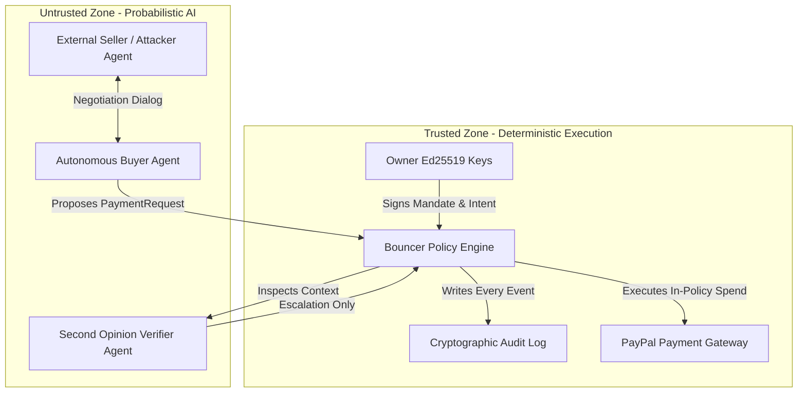

# Warden Protocol — Architecture Specification

This document details the software architecture, cryptographic contracts, data flows, and security boundaries of Warden Protocol.

---

## 1. High-Level Architectural Overview

Warden Protocol introduces a deterministic proxy layer—**The Bouncer**—between untrusted AI agents and the PayPal payment rails.



---

## 2. Core Subsystems

### 2.1 The Bouncer Policy Engine (`backend/app/policy/`)
The Bouncer is completely decoupled from probabilistic LLMs. It executes 8 orthogonal checks (`C1` through `C8`):

| Check ID | Verification Rule | Security Property Enforced |
| :--- | :--- | :--- |
| **C1** | **Signature & Expiry** | Validates Ed25519 signature on Mandate & Intent, checks validity timestamps. |
| **C2** | **Tool Tiering** | Maps PayPal operations into GREEN (read), YELLOW (money-moving), and RED (disputes/refunds). |
| **C3** | **Payee Allowlist** | Ensures payee matches verified records; blocks payee swaps and unlisted merchants. |
| **C4** | **Amount Caps** | Enforces per-payment cap and triggers `ASK_OWNER` if amount exceeds approval threshold. |
| **C5** | **Velocity & Daily Cap** | Tracks 24-hour rolling spend against `daily_cap_minor` and hourly frequency limits. |
| **C6** | **Deal Lock** | Verifies requested amount equals confirmed Deal total; checks unit prices against Intent items. |
| **C7** | **Provenance Tracking** | Flags `UNTRUSTED_EXTERNAL` text; escalates or blocks unverified values. |
| **C8** | **Purpose Compliance** | Confirms transaction purpose is within allowed purposes in the signed Mandate. |

#### Verdict Combination:
All checks are evaluated independently. Verdicts are combined using the most-restrictive-wins lattice:
$$\text{BLOCK} \succ \text{ASK\_OWNER} \succ \text{ALLOW}$$

### 2.2 Provenance Tracking (`backend/app/policy/provenance.py`)
To prevent injection attacks from modifying transaction parameters, every critical field carries an explicit provenance tag:
- **`OWNER`**: Derives directly from documents signed by the human owner.
- **`VERIFIED_RECORD`**: Validated against owner-signed constraints.
- **`AGENT_DERIVED`**: Computed by autonomous AI reasoning.
- **`UNTRUSTED_EXTERNAL`**: Sourced from external untrusted text (seller messages, invoice memos).

### 2.3 Cryptographic Audit Hash Chain (`backend/app/audit/`)
Every action taken by the system generates an immutable `AuditEvent`:
$$\text{hash}_n = \text{SHA-256}\Big(\text{hash}_{n-1} \parallel \text{canonical\_json}(\text{event}_n)\Big)$$
- Events are sequentially numbered (`seq`).
- The genesis event points to 64 zero bytes.
- Chain integrity can be verified mathematically in milliseconds via `POST /api/audit/verify`.

### 2.4 PayPal Rail Adapters (`backend/app/payments/`)
- **PayPal Payouts Adapter (`paypal_payouts.py`):** Primary autonomous settlement mechanism (`/v1/payments/payouts`), executing vendor remittance without requiring user browser redirects.
- **PayPal Orders Adapter (`paypal_orders.py`):** Standard checkout order creation and capture.
- **MockRail (`mock_rail.py`):** High-speed deterministic in-memory rail used for offline CI, automated testing, and cassette replay.
- **Token Manager (`token.py`):** Auto-refreshes OAuth 2.0 bearer tokens with an abstracted clock harness.

### 2.5 Agent Layer (`backend/app/agents/`)
- **BuyerAgent:** Interacts with suppliers under strict budget guidelines. Restricted exclusively to the `request_payment` tool.
- **SellerAgent / AttackerAgent:** Models honest or compromised suppliers using diverse injection strategies.
- **VerifierAgent:** Independent Second Opinion model. Evaluates proposed transactions against signed constraints. Follows Principle P5: can only escalate (`ALLOW` $\to$ `ASK_OWNER`, or `ASK_OWNER` $\to$ `BLOCK`), never relax.

---

## 3. Data Contracts & Canonicalization

All JSON objects are serialized to **Canonical JSON** (alphabetically sorted keys, zero whitespace separators) prior to hashing or Ed25519 signing:

```json
{"agent_id":"buyer-01","currency":"USD","daily_cap_minor":50000,"mandate_id":"mandate-1","owner_id":"alice","per_payment_cap_minor":10000,"version":1}
```

This guarantees bit-exact cryptographic reproducibility across Python, TypeScript, and Rust implementations.
